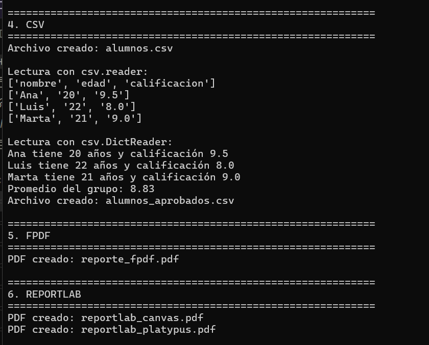
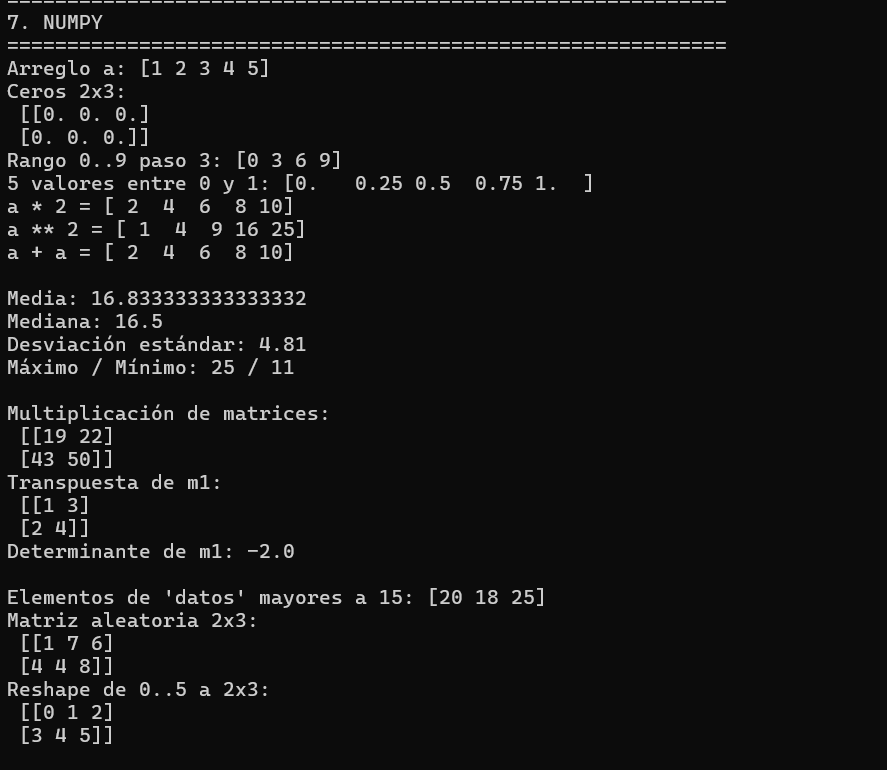
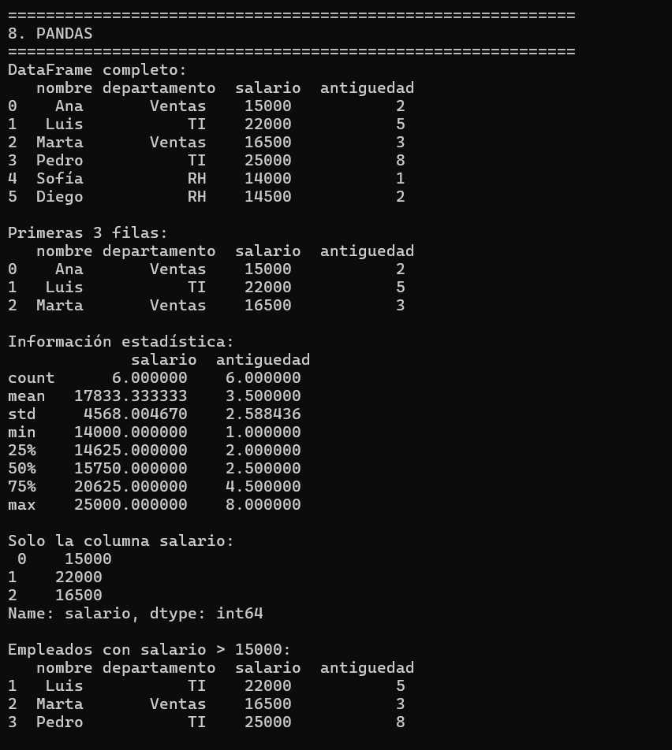
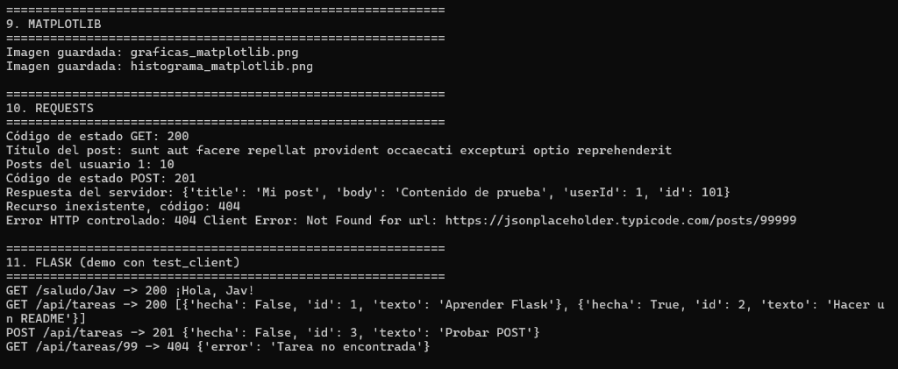
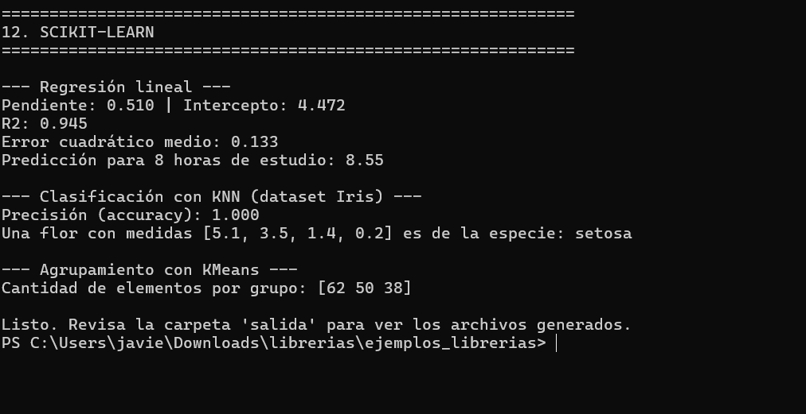

# Ejemplos de librerías en Python

Proyecto didáctico con un ejemplo funcional por cada una de estas librerías:
**math, random, datetime, csv, fpdf, reportlab, NumPy, Pandas, Matplotlib, Requests, Flask y scikit-learn**.

Incluye una **aplicación de escritorio ejecutable (.exe)** con una **interfaz gráfica moderna** que permite visualizar y ejecutar todas las opciones de manera individual o por lote, ver la consola integrada en tiempo real y abrir los archivos generados con un solo clic.

---

## Estructura del proyecto

```
ejemplos_librerias/
├── EjemplosLibrerias.exe      <- Ejecutable de Windows (doble clic para abrir la ventana con todas las opciones)
├── ejecutar.bat               <- Acceso directo para iniciar la aplicación
├── compilar.bat               <- Script para recompilar el ejecutable con PyInstaller
├── gui.py                     <- Interfaz gráfica moderna (Tkinter / TTK)
├── main.py                    <- Punto de entrada (abre la GUI o ejecuta en consola con --cli)
├── utilidades.py              <- Funciones auxiliares (carpeta de salida, títulos)
├── README.md                  <- Este archivo
├── requirements.txt           <- Librerías a instalar
├── capturas/                  <- Capturas de pantalla de la ejecución
├── ejemplo_01_math.py
├── ejemplo_02_random.py
├── ejemplo_03_datetime.py
├── ejemplo_04_csv.py
├── ejemplo_05_fpdf.py
├── ejemplo_06_reportlab.py
├── ejemplo_07_numpy.py
├── ejemplo_08_pandas.py
├── ejemplo_09_matplotlib.py
├── ejemplo_10_requests.py
├── ejemplo_11_flask.py
├── ejemplo_12_sklearn.py
└── salida/                    <- Se crea sola; aquí se guardan CSV, PDF e imágenes
```

## Formas de ejecución

### 1. Usar el Ejecutable (.exe) directo (Sin necesidad de comandos)
Haz doble clic sobre **`EjemplosLibrerias.exe`** o sobre **`ejecutar.bat`**.
Se abrirá inmediatamente la ventana interactiva donde puedes:
- Ejecutar cualquiera de los 12 ejemplos individualmente con el botón **▶ Ejecutar**.
- Ejecutar los 12 ejemplos en secuencia con el botón **▶ Ejecutar Todo**.
- Filtrar por categorías (*Estándar, Archivos, Datos, Web y ML*) o buscar por texto.
- Ver la consola integrada con colores y salida en tiempo real.
- Abrir la carpeta `salida/` o previsualizar directamente los PDFs, CSVs e imágenes generadas.

### 2. Desde Python

```bash
# Abrir la interfaz gráfica interactiva:
python main.py

# Ejecutar todos los ejemplos en consola tradicional:
python main.py --cli

# Ejecutar un ejemplo específico:
python ejemplo_07_numpy.py
python ejemplo_11_flask.py        # Levanta el servidor web local de Flask
```

### 3. Recompilar el ejecutable
Si modificas los ejemplos o la interfaz gráfica y deseas generar nuevamente el archivo `.exe`:
- Simplemente haz doble clic en **`compilar.bat`**, o
- Ejecuta en terminal:
  ```bash
  python -m PyInstaller --onefile --noconsole --name "EjemplosLibrerias" --clean --noconfirm main.py
  ```

---

## Capturas de pantalla de la ejecución

Evidencia de la salida en consola al ejecutar el comando `python main.py`:

### 1. CSV, FPDF y ReportLab (Ejemplos 4, 5 y 6)
Creación y lectura de archivos CSV con `reader` y `DictReader`, y generación de reportes PDF tanto con Canvas como con Platypus:



### 2. NumPy (Ejemplo 7)
Creación de arreglos, operaciones vectorizadas, estadísticas básicas (media, mediana, desviación estándar) y álgebra lineal (multiplicación de matrices y determinante):



### 3. Pandas (Ejemplo 8)
Creación y visualización de un `DataFrame`, resumen con `describe()`, selección de columnas y filtrado de registros por condición de salario:



### 4. Matplotlib, Requests y Flask (Ejemplos 9, 10 y 11)
Guardado de gráficas e histogramas, consumo de la API de pruebas con `requests` (GET, POST y manejo de errores 404), y pruebas de rutas del servidor Flask con `test_client`:



### 5. scikit-learn (Ejemplo 12)
Modelado de regresión lineal (cálculo de pendiente, intercepto, R² y predicción), clasificación de especies con KNN en el dataset Iris, y agrupamiento no supervisado con KMeans:



---

## Explicación de cada ejemplo

### 1. `math` — Funciones matemáticas (`ejemplo_01_math.py`)
Librería estándar para cálculos matemáticos más allá de las operaciones básicas.

| Qué muestra | Funciones |
|---|---|
| Constantes | `math.pi`, `math.e` |
| Raíces, potencias, logaritmos | `sqrt`, `pow`, `log`, `log10` |
| Redondeo | `ceil` (hacia arriba), `floor` (hacia abajo) |
| Trigonometría | `sin`, `cos`, `radians` (los ángulos van en **radianes**) |
| Otras | `factorial`, `gcd` (máximo común divisor) |

Cierra con un caso práctico: calcular el área de un círculo.

### 2. `random` — Números aleatorios (`ejemplo_02_random.py`)
Genera valores y selecciones al azar.

- `random.seed(42)`: fija la semilla para que los resultados sean **repetibles**.
- `randint(a, b)`, `random()`, `uniform(a, b)`: enteros y decimales aleatorios.
- `choice(lista)` elige un elemento; `sample(lista, k)` elige `k` elementos sin repetir.
- `shuffle(lista)` mezcla la lista original.
- Casos prácticos: simular 10 tiradas de dado y generar una clave aleatoria de 8 caracteres.

### 3. `datetime` — Fechas y horas (`ejemplo_03_datetime.py`)
- `datetime.now()` y `date.today()`: fecha y hora actuales.
- `strftime(formato)`: convierte una fecha a **texto** (`%d/%m/%Y`, `%H:%M:%S`...).
- `strptime(texto, formato)`: convierte un **texto** a fecha.
- `timedelta`: suma y resta días, semanas, etc.
- Resta de fechas para obtener los días transcurridos y calcular una edad.
- `weekday()`: devuelve el día de la semana (0 = lunes).

### 4. `csv` — Archivos CSV (`ejemplo_04_csv.py`)
Lee y escribe hojas de datos en texto plano.

- `csv.writer` / `writerows`: escribe filas desde listas.
- `csv.reader`: lee cada fila como una lista.
- `csv.DictReader`: lee cada fila como un **diccionario** (se accede por nombre de columna).
- `csv.DictWriter`: escribe desde diccionarios, con encabezado (`writeheader`).
- Genera `alumnos.csv` y `alumnos_aprobados.csv`, y calcula el promedio del grupo.

### 5. `fpdf` — PDFs sencillos (`ejemplo_05_fpdf.py`)
Crea documentos PDF de manera sencilla con una clase `PDF` personalizada.

- `header()` y `footer()`: encabezado y pie de página automáticos (con número de página).
- `cell()`: escribe una celda de texto (con borde, para formar tablas).
- `multi_cell()`: párrafos con salto de línea automático.
- `line()`: dibuja líneas.
- Genera `reporte_fpdf.pdf` con texto, una tabla de productos y una línea.

### 6. `reportlab` — PDFs profesionales (`ejemplo_06_reportlab.py`)
Más potente que fpdf; muestra **dos formas** de trabajar:

1. **Canvas (bajo nivel):** se dibuja en coordenadas `(x, y)`: texto, rectángulos y círculos. Genera `reportlab_canvas.pdf`.
2. **Platypus (alto nivel):** se arma una lista de elementos (`Paragraph`, `Spacer`, `Table`) y la librería los acomoda sola. Incluye estilos de tabla con colores. Genera `reportlab_platypus.pdf`.

### 7. `NumPy` — Cálculo numérico (`ejemplo_07_numpy.py`)
Arreglos (`ndarray`) rápidos para operar con muchos datos a la vez.

- Creación: `array`, `zeros`, `arange`, `linspace`.
- **Operaciones vectorizadas:** `a * 2` multiplica todos los elementos sin usar bucles.
- Estadística: `mean`, `median`, `std`, `max`, `min`.
- Álgebra lineal: multiplicación de matrices (`@`), transpuesta (`.T`), determinante (`np.linalg.det`).
- Indexación booleana: `datos[datos > 15]`.
- `reshape` para cambiar la forma de un arreglo y generador aleatorio `default_rng`.

### 8. `Pandas` — Análisis de datos (`ejemplo_08_pandas.py`)
Trabaja con tablas (`DataFrame`) de empleados.

- Crear un `DataFrame` desde un diccionario; `head()` y `describe()` para explorarlo.
- Seleccionar columnas y **filtrar** filas (`df[df["salario"] > 15000]`).
- Crear una columna calculada (`salario_anual`).
- `groupby(...).mean()`: promedio de salario por departamento.
- `sort_values()`: ordenar.
- `to_csv()` y `read_csv()`: guardar y leer archivos.

### 9. `Matplotlib` — Gráficas (`ejemplo_09_matplotlib.py`)
Crea una imagen con **cuatro tipos de gráfica** y un histograma aparte:

- **Líneas** (seno y coseno con leyenda y cuadrícula).
- **Barras** (ventas por mes).
- **Dispersión** (puntos aleatorios con color).
- **Pastel** (porcentajes).
- **Histograma** (distribución normal de 500 datos).

Usa el backend `Agg` para guardar las imágenes (`graficas_matplotlib.png`, `histograma_matplotlib.png`) sin abrir ventanas. Si quieres verlas en pantalla, quita esa línea y usa `plt.show()`.

### 10. `Requests` — Peticiones HTTP (`ejemplo_10_requests.py`)
Consume la API pública de pruebas `jsonplaceholder.typicode.com`.

- `requests.get()`: obtiene datos; `.status_code` da el código HTTP y `.json()` convierte la respuesta a diccionario.
- `params={...}`: parámetros en la URL (`?userId=1`).
- `requests.post(json=...)`: envía datos al servidor.
- `timeout`: evita que el programa se quede esperando.
- Manejo de errores con `raise_for_status()` y `RequestException`.

> **Requiere Internet.** Si no hay conexión, el programa muestra un aviso y no se cae.

### 11. `Flask` — Aplicación web y API (`ejemplo_11_flask.py`)
Mini servidor web con las siguientes rutas:

| Ruta | Método | Qué hace |
|---|---|---|
| `/` | GET | Página HTML de inicio |
| `/saludo/<nombre>` | GET | Saluda usando un parámetro de la URL |
| `/api/tareas` | GET | Lista las tareas en JSON |
| `/api/tareas` | POST | Crea una tarea nueva (recibe JSON con `texto`) |
| `/api/tareas/<id>` | GET | Devuelve una tarea o un error 404 |

**Dos formas de usarlo:**

- **Servidor real:** `python ejemplo_11_flask.py` y abrir <http://127.0.0.1:5000>. Para probar el POST:
  ```bash
  curl -X POST http://127.0.0.1:5000/api/tareas \
       -H "Content-Type: application/json" \
       -d '{"texto": "Nueva tarea"}'
  ```
- **Demo automática:** `main.py` usa `app.test_client()`, que prueba las rutas sin abrir ningún puerto.

Los datos se guardan en una lista en memoria (se pierden al cerrar el servidor); es solo para fines de demostración.

### 12. `scikit-learn` — Aprendizaje automático (`ejemplo_12_sklearn.py`)
Tres tareas típicas de machine learning:

1. **Regresión lineal:** predice la calificación a partir de las horas de estudio. Se divide en datos de entrenamiento y de prueba (`train_test_split`) y se evalúa con R² y error cuadrático medio.
2. **Clasificación (KNN):** con el dataset de flores *Iris*, entrena un clasificador de vecinos más cercanos, mide su precisión y predice la especie de una flor nueva.
3. **Agrupamiento (KMeans):** agrupa las flores en 3 grupos **sin usar las etiquetas** (aprendizaje no supervisado).

Flujo básico que se repite: **crear el modelo → `fit()` (entrenar) → `predict()` (predecir) → evaluar**.

---

## Problemas frecuentes

- **`ModuleNotFoundError`:** falta instalar la librería; ejecuta `pip install -r requirements.txt`.
- **Error con `fpdf`:** asegúrate de instalar `fpdf2` y no el paquete antiguo `fpdf`.
- **Requests falla:** revisa tu conexión a Internet.
- **Flask: puerto ocupado:** cambia el puerto con `app.run(port=5001)`.

## Para seguir aprendiendo

Documentación oficial de cada librería: [Python (math, random, datetime, csv)](https://docs.python.org/3/library/) · [fpdf2](https://py-pdf.github.io/fpdf2/) · [ReportLab](https://docs.reportlab.com/) · [NumPy](https://numpy.org/doc/) · [Pandas](https://pandas.pydata.org/docs/) · [Matplotlib](https://matplotlib.org/stable/) · [Requests](https://requests.readthedocs.io/) · [Flask](https://flask.palletsprojects.com/) · [scikit-learn](https://scikit-learn.org/stable/)
